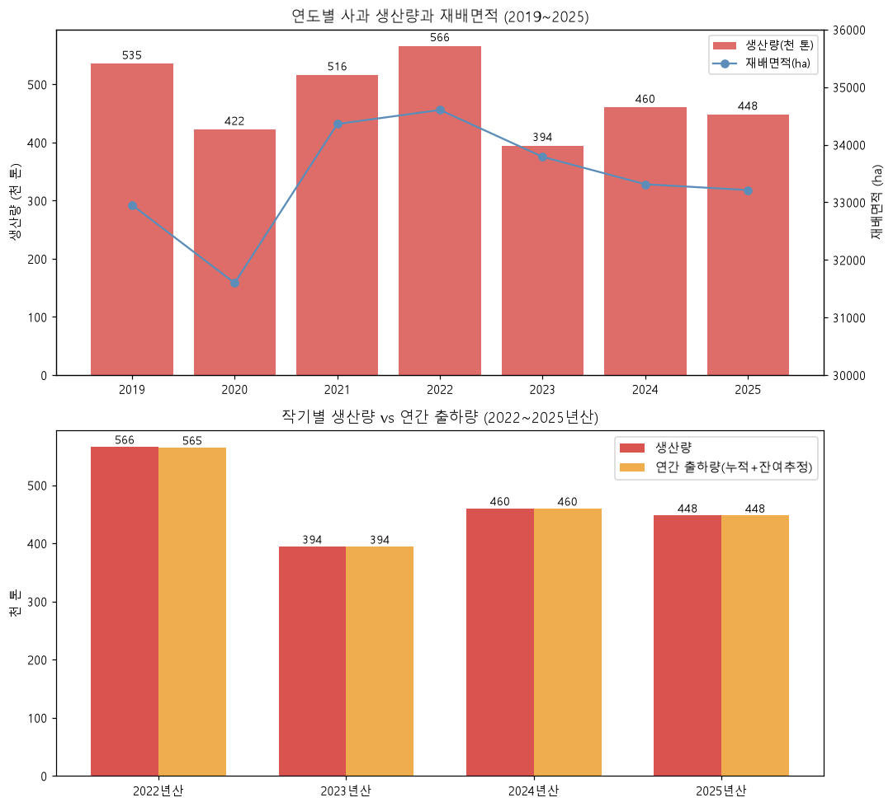
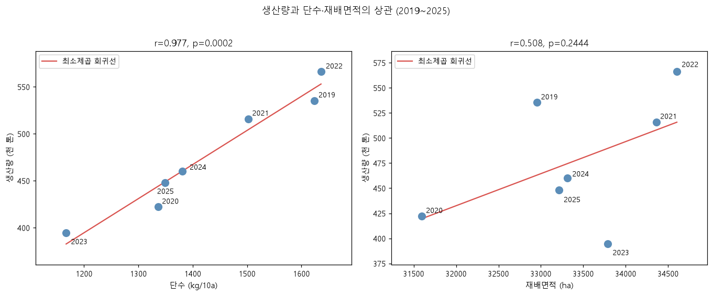
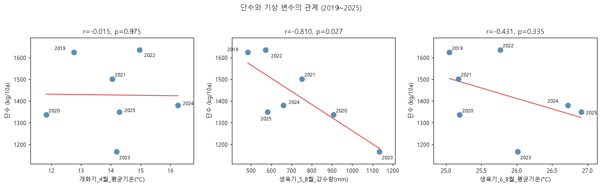

# 사과 생산량·출하량 비교 분석 보고서

**분석자: J kevin · 2026년 10월 29일**

KREI(한국농촌경제연구원) 과일 관측월보에서 추출된 `apple_production_shipment.csv`(740행 × 9열)를 원본 CSV에서 수치와 결론을 독립적으로 다시 산출하는 방식으로 분석했다. 이 보고서의 모든 수치는 원본 CSV에서 새로 계산한 값이며, 계산 과정과 그래프는 `사과 생산량·출하량 분석.ipynb`에서 확인할 수 있다.

---

## 1. 분석 목적과 원칙

이 분석에서 답하려는 질문은 다음과 같다.

1. 생산량과 출하량을 비교했을 때 잉여(활용되지 못하는) 사과가 존재하는가?
2. 잉여가 있다면 생산량을 줄여야 하는가?
3. 출하되지 못한 사과는 어떤 과정을 거치는가?
4. 생산량 변동은 무엇에 의해 결정되는가?
5. 단수(10a당 수확량)는 기상 조건과 어떤 관계인가?

분석 원칙은 이렇다.

- 월보는 같은 연도의 수치를 여러 호수에서 반복 게시하고 수정하므로, 기준 연도(`구분` 열)별로 **가장 최신 발간월의 값 하나만** 사용한다.
- 출하량은 작기 단위로 다루며, 발간 시점별 부분 합을 함부로 조합하지 않는다.
- 월보의 출하량 수치는 실적과 전망이 섞일 수 있고([KREI 농업관측 매뉴얼](https://www.krei.re.kr/attach/pdf/605ba745-9c0f-2a94-e054-b09928988b3c.pdf)에서 공통 산식을 확인할 수 없었다), 생산량−출하량 차이를 곧바로 '잉여·폐기량'으로 해석하지 않는다.
- 생산량은 재배면적 × 단수의 항등식으로 결정되므로, 상관계수가 인과관계를 의미하지 않음을 명시한다.

## 2. 데이터 검증

740행 × 9열 구조에서(원본 헤더 직접 확인) 결측치와 완전 중복 없이 수집되어 있다. 값·하한·상한이 서로 다른 행은 36개(2024년 11월 호, 2025년 7~11월 호의 수확기 추정치)로, 이들은 값이 중간값이고 하한~상한 범위가 함께 표기된 추정 구간이다. 나는 기준 연도별 최신 발간월을 사용하므로 시즌 종료 후 게시된 단일값을 사용한다.

## 3. EDA (탐색적 데이터 분석)

표·구분·항목의 계층 구조와 발간 시점 분포를 파악했고, 다음을 확인했다.

**열 수(9열)로 재분석하게 된 사유:** 원본 CSV의 첫 행을 직접 열어 헤더를 확인한 결과, 열이 `발간월, 표, 구분, 항목, 값, 하한, 상한, 원문, 단위`의 **9개**임을 확인했다. 앞선 분석에서 10열로 기재한 것은 pandas가 데이터프레임에 자동 부여하는 행 번호 인덱스를 데이터 열로 함께 센 것으로 판단된다. 행 번호는 표시용 인덱스이지 데이터가 아니므로, 나는 인덱스를 제외한 9열을 기준으로 이번 분석 전체를 다시 수행했다.

1. **생산량 표**는 기준 연도(2019~2026년)·평년·증감률로 구성되고, 항목은 재배면적·단수·생산량 3가지다.
2. **출하량 표**는 작기(예: 2022년산) 기준이며 기간 표기가 발간 시점마다 다르다. 10월 호는 `10월`+`11월 이후`, 4~6월 호는 `7월~익년 N월`+`N+1월 이후` 형태다. 같은 작기라도 발간 호수에 따라 수치가 수정된다.
3. **저장량 표**는 12월 발간호에만 있고(2022·2023·2025년 12월), 12월 시점 저장 물량을 뜻한다.
4. 첨부자료에는 2024년 5~10월 발간분이 수록되어 있지 않다. 이것은 월보가 발간되지 않았다는 증거가 아니라 **첨부자료의 수록 공백**이므로, 모든 작기의 출하량을 동일한 방식으로 재구성할 수는 없다. 그래서 나는 연간 출하량을 **작기 전체를 커버하는 동일 호수의 누적 수치 기준**으로만 구성했다.
5. 첨부자료 기준 연도별 발간 호수는 2020년 1, 2021년 1, 2022년 9, 2023년 9, 2024년 3, 2025년 9, 2026년 7호다.

## 4. 연도별 생산량 (최신 게시치)

| 연도 | 근거 발간월 | 재배면적(ha) | 단수(kg/10a) | 생산량(천 톤) | 면적×단수 검산 오차 |
|---|---|---:|---:|---:|---:|
| 2019 | 202012 | 32,954 | 1,624 | 535.3 | −0.02% |
| 2020 | 202110 | 31,598 | 1,336 | 422.1 | +0.01% |
| 2021 | 202212 | 34,359 | 1,502 | 515.9 | +0.03% |
| 2022 | 202312 | 34,603 | 1,636 | 566.0 | +0.02% |
| 2023 | 202412 | 33,789 | 1,167 | 394.4 | −0.02% |
| 2024 | 202512 | 33,313 | 1,381 | 460.1 | −0.01% |
| 2025 | 202610 | 33,212 | 1,349 | 448.0 | +0.01% |
| 2026(추정) | 202610 | 34,901 | 1,385 | 483.3 | +0.02% |

전 연도에서 면적 × 단수 검산 오차가 ±0.04% 이내로 일치해 자료 정합성을 확인했다. 2026년은 수확 초기 추정치다.

## 5. 작기별 연간 출하량과 생산-출하 차이

| 작기 | 생산량(천 톤) | 연간 출하량(천 톤) | 생산-출하 차이(천 톤) | 출하/생산 | 근거 발간월 |
|---|---:|---:|---:|---:|---|
| 2022년산 | 566.0 | 564.6 | 1.4 | 99.75% | 202404 |
| 2023년산 | 394.4 | 394.1 | 0.3 | 99.92% | 202506 |
| 2024년산 | 460.1 | 459.7 | 0.4 | 99.91% | 202606 |
| 2025년산 | 448.0 | 447.7 | 0.3 | 99.93% | 202606 |

여기서 연간 출하량은 **동일 호수의 누적 출하량 + 잔여기간 추정 합계**다. 각 호수의 수치는 실적과 전망이 섞여 있을 수 있으므로(예: 6월 호의 `6월 이후`는 잔여기간 전망 포함 가능) '확정 연간값'이 아니다.

**나의 판단:** 이 자료에는 잉여·폐기·미활용 물량을 직접 측정하는 항목이 없어서 잉여 규모는 판단을 유보한다. 관측되는 것은 집계상 잔차(작기당 0.3~1.4천 톤, 생산량의 0.07~0.25%)뿐이고, 월보의 출하량이 생산량을 작기별로 배분한 값일 가능성은 있지만 이는 확인된 산식이 아니라 나의 해석상 가설이다.

12월 시점 저장량은 2021년산 278.0 → 2022년산 292.0 → 2023년산 202.7 → 2024년산 229.5 → 2025년산 228.6천 톤으로, 2023년 흉작 때 급감했다. 저장량은 출하 시기를 조절하는 유통 물량이므로 곧 '잉여'를 뜻하지는 않으며, 적체 여부는 가격·소비 자료와 함께 판단해야 한다.

## 6. 잉여 사과가 활용되지 못했을 때의 경로

월보에는 처우 정보가 없다. 나는 외부 근거를 조사했고, 한국사과연합회는 가격이 크게 하락할 때 물량 감축 수단으로 출하조절, 비정형과 분리, 가공용 전환(주스·사과즙), 산지폐기를 제시한다([동아일보, 2026.8.30](https://v.daum.net/v/20260830100152655)).

이것을 '반드시 순서대로 거치는 절차'가 아니라 **물량의 상태·안전성·저장 여력에 따른 대안들**로 정리했다:

- 저장성이 높고 품질이 유지되면 → 저장 후 분할 출하 (출하조절)
- 상품성이 낮으면 → 선별 후 가공용 전환 (품질이 낮다고 모두 식품 가공에 적합한 것은 아님)
- 식용으로 활용할 수 없으면 → 산지폐기 등 적정 처리 경로

실제 처분 이력은 이 자료로 확인되지 않는다.

## 7. 상관관계 분석 — 생산량은 단수와 면적 중 무엇에 의해 움직이는가

### 상관계수를 도출한 방법과 근거

- **방법:** 피어슨(Pearson) 적률 상관계수. r = Σ(xᵢ−x̄)(yᵢ−ȳ) / √(Σ(xᵢ−x̄)²·Σ(yᵢ−ȳ)²), 즉 표준화된 공분산(−1 ≤ r ≤ 1).
- **표본:** 2019~2025년 7개 연도(n=7). 2026년은 추정치라 제외.
- **유의성 검정:** 귀무가설 '모상관계수=0' 아래 t = r√(n−2)/√(1−r²)이 자유도 5인 t분포를 따른다는 가정으로 p값 계산(scipy.stats.pearsonr). p값은 '귀무가설과 검정 가정이 참일 때 관측된 것만큼 극단적인 통계량이 나올 확률'이다. 유의수준 5%.
- **가정:** 피어슨 r 계산 자체는 정규성·등분산성을 요구하지 않는다. 다만 t검정으로 p값을 해석하려면 관측쌍의 독립성과 이변량 정규성이 가정되어야 한다. n=7에서 엄밀한 검증은 어렵다.
- **한계:** 생산량 = 면적 × 단수 × 10⁻⁵라는 항등식이 성립하므로 상관이 인과의 증거가 아니다. 상관의 의미는 '어느 요인의 변동이 생산량 변동을 주도했는가' 확인이다.

### 결과

- 생산량 ~ 단수: **r=0.977, p=0.0002** (매우 강한 양의 상관)
- 생산량 ~ 재배면적: **r=0.508, p=0.244** (유의수준 5%에서 기각되지 않음)
- 재배면적 ~ 단수: r=0.312, p=0.496 (이 표본에서 관계를 확정할 근거 부족)

로그 변화율 분해(Δln 생산량 = Δln 면적 + Δln 단수)에서 매년 생산량 변동의 대부분이 단수에서 나왔다. 예: 2022→2023년 생산량 로그 변화율 −36.1% 중 단수 기여 −33.8%p, 2019→2020년 −23.8% 중 단수 기여 −19.5%p. 즉 **연도별 생산량 변동은 단수(작황)가 주도하고 재배면적은 완만한 배경 요인**이다. 산점도와 회귀선은 아래 그래프와 노트북 7단계에서 확인할 수 있다.

## 8. 기상 자료를 결합한 단수 분석 (탐색적)

사과 주산지(경북 안동·상주, 충북 충주)의 2019~2025년 일별 기온·강수량을 [Open-Meteo Historical Weather API](https://open-meteo.com/en/docs/historical-weather-api)에서 `models=era5`를 명시해 수집하고 월별 CSV로 정리했다(3개 지점 × 84개월 = 252행, 일별 결측 0건). 파일: `apple_region_weather_monthly_2019_2025.csv` (수집 URL·좌표·검증 코드는 노트북 8단계에 기록)

- 단수 ~ 생육기(5~8월) 강수량: **r=−0.810, 비보정 p=0.027** — 생육기 강수가 많았던 2020년(907mm)·2023년(1,135mm)에 단수가 낮았다(1,336·1,167kg/10a). 세 변수를 탐색한 다중 검정이므로 단순 Bonferroni 보정을 적용하면 p≈0.082로 5% 수준을 넘는다. 그래서 나는 이 결과를 '통계적으로 유의하다'가 아니라 **유망한 탐색적 가설**로만 제시한다.
- 단수 ~ 개화기(4월) 평균기온: r=−0.015 (이 표본에서 관계를 확정할 근거 부족. 서리·저온 피해는 최저기온·시점에 따라 결정되므로 월평균기온으로 포착되지 않을 가능성을 별도 기록)
- 단수 ~ 생육기(6~8월) 평균기온: r=−0.431, p=0.335 (유의하지 않음)

**한계:** ERA5는 관측값을 모형으로 재구성한 재분석 자료(좌표 기반, 관측소 실측 아님)이며, 3개 지점 평균이 전국 재배지를 대표하지 못한다. n=7이므로 탐색적 가설 수준이며, 단수는 기상 외에 품종·수령·병해·관리의 영향도 받는다. 강수-단수 음의 상관에 대한 생물학적 해석(일조 부족·병해)은 후속 검증이 필요한 가설이다.

## 9. 결론

1. **잉여 사과:** 이 자료로는 잉여·폐기·미활용 규모를 측정할 수 없어 판단을 유보한다. 관측되는 생산-출하 집계상 잔차는 작기당 0.07~0.25%뿐이고, 출하량 자체가 실적과 전망이 섞인 조사치다. 잉여 여부는 소비·가격·재고 자료와 결합해야 판단할 수 있다.
2. **생산량 축소 여부:** 이 자료만으로 감산을 권고할 근거가 없다. 2023년 흉작 후 생산은 회복 중이고(2024년 460.1, 2025년 448.0천 톤) 12월 저장량도 전작과 비슷하다. 외부 정보를 보면 1인당 소비량은 감소 전망(2026년 8.6kg → 2035년 8.1kg), 도매가격은 고공(2025년 86,687원/10kg)이어서([KIFC](https://www.foodandclimate.or.kr/food-security/commodity-outlook/apple/)), 수요 대비 공급 과잉 여부는 가격·소비 자료 없이는 결론할 수 없다. 이 표본의 생산량 변동에는 면적보다 단수의 변화가 크게 동반됐으므로, 면적을 줄여도 작황에 따른 변동은 사라지지 않는다. **감산 권고는 유보가 자료에 충실한 결론이다.**
3. **미출하 사과의 처우:** 저장 후 분할 출하, 선별 후 가공 전환, 적정 처리(폐기 등)가 상태에 따른 대안이다(한국사과연합회). 실제 처분 이력은 확인되지 않는다.
4. **생산 변동 구조:** 단수(r=0.977)가 주도하고 재배면적(r=0.508)은 배경 요인이다. 단수는 생육기 강수량과 음의 상관(r=−0.810, 보정 후 유의성 약화)을 보였다.

## 10. 향후 보완이 필요한 것

1. **소비·가격 자료 결합:** KAMIS(농산물유통정보) 도·소매 가격, 1인당 소비량, 품질(대과 비중) 자료를 결합해야 잉여 판단이 가능하다.
2. **가공·폐기 물량 실측:** 미출하·가공용 물량 실태자료(자조금·aT 조사) 확보가 필요하다.
3. **기상 자료 정밀화:** 기상청 관측값, 지역별(군 단위) 생산량, 개화기 최저기온·서리 일수, 생육기 일조시간 결합이 필요하다.
4. **표본 수 확대:** 연도 7개는 상관분석에 부족하다. 2000년대 이후로 확장하고 지역 패널 구성을 권한다.
5. **출하량 정의 확인:** 월보 출하량의 작기 정의와 실적/전망 구분을 KREI 원문에서 문서로 확인해야 한다.
6. **2026년산 추적:** 2026년 10월 추정치(483.3천 톤)는 이후 호수에서 수정된다.

## 11. 기상 자료 확보 방안

1. **기상자료개방포털(data.kma.go.kr):** 회원가입 후 지상(지면)관측 자료를 조회·다운로드한다. 실측 관측값이라 가장 권장된다([기상청 안내](https://www.kma.go.kr/info_open/public_data/guidepage.jsp)).
2. **공공데이터포털(data.go.kr):** '기상청_지상관측 자료' 파일데이터/API로 같은 자료를 확보할 수 있다.
3. **Open-Meteo Historical API:** 키 없이 즉시 사용 가능한 재분석 자료. 본 분석에서는 `models=era5`를 명시해 수집했다. 관측값의 모형 재구성임을 유의.
4. **본 분석에서 수집한 자료:** `apple_region_weather_monthly_2019_2025.csv` — 안동·상주·충주 3개 지점의 2019~2025년 월별 평균기온·강수량(Open-Meteo ERA5 기반, 일별 결측 0건).
5. **향후 권장:** 농림축산식품부 사과생산통계(시·군 단위)와 기상 관측값을 연도·지역 키로 병합하는 구조가 필요하다.

---

### 참고 자료

- KREI [농업관측 매뉴얼](https://www.krei.re.kr/attach/pdf/605ba745-9c0f-2a94-e054-b09928988b3c.pdf)
- [동아일보, 사과값 떨어지면 주스로 만들면 끝? (2026.8.30)](https://v.daum.net/v/20260830100152655)
- [KIFC, 사과 시장 구조 분석](https://www.foodandclimate.or.kr/food-security/commodity-outlook/apple/)
- [농림축산식품부, 2025년산 사과·배 생산량 보도자료](https://www.mafra.go.kr/bbs/home/792/576278/artclView.do)
- [Open-Meteo Historical Weather API](https://open-meteo.com/en/docs/historical-weather-api)
- [기상자료개방포털](https://data.kma.go.kr/cmmn/static/staticPage.do?page=intro)
